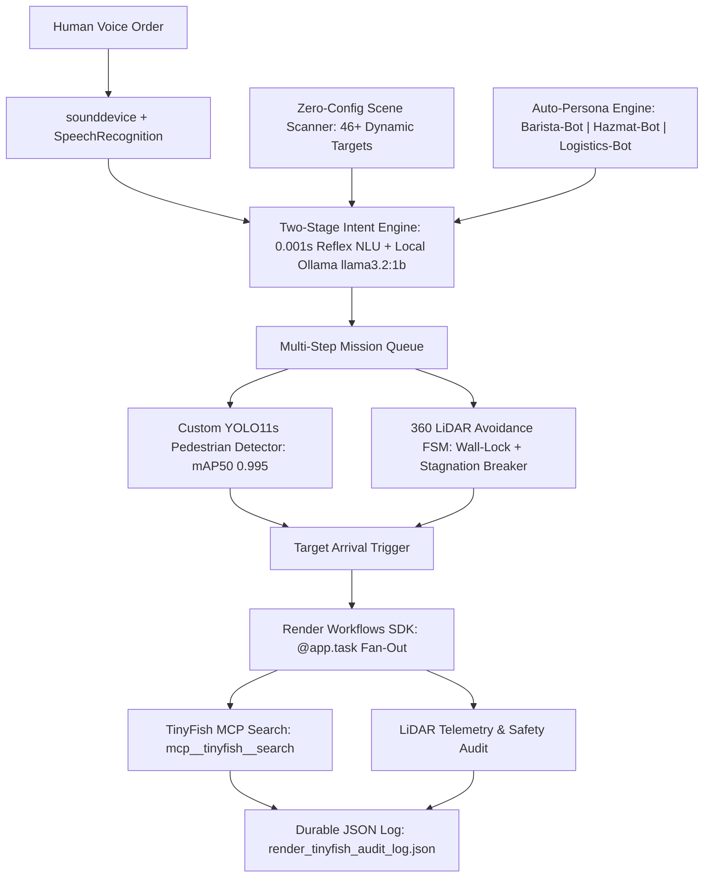

# 🤖 AURA-Fleet: Multi-Persona Voice-Commanded Vision Bots
> **Hack in Hills '26 — Powered by TinyFish & Render Workflows**

[](#4-benchmark-results-120-automated-multi-scenario-trials)
[](#4-benchmark-results-120-automated-multi-scenario-trials)
[](#5-tinyfish-mcp--render-workflows-integration)
[](#5-tinyfish-mcp--render-workflows-integration)

---

## 📌 1. Problem Statement & Multi-Bot Vision
Service and industrial robots today are locked into single-purpose behaviors:
1. **Static Automation Blindness:** Traditional AGVs follow fixed floor lines—they cannot dynamically locate moving humans, understand chained voice orders, or adapt across different environments.
2. **One-Size-Fits-All Rigidity:** A cafe waiter robot needs playful hospitality and table-service routing, whereas a factory robot needs OSHA hazmat compliance and safety escorting.
3. **Disconnected from Live Web Intelligence:** Physical robots cannot query live web data (cafe allergen/menu data, OSHA hazmat standards, warehouse SKUs) during physical tasks.

**AURA-Fleet** solves this with a single **Universal Embodied AI Brain** that automatically detects its environment and morphs into specialized **Vision Bots**:
- ☕ **Barista-Bot (Cafe / Break Room Waiter):** Playful hospitality waiter that picks up orders from the `sink`/`counter`, serves `sofa` & `table` guests, and tracks customers.
- 🦺 **Hazmat-Bot (Factory Safety Officer):** Inspects `forklift`, `gas canister`, and `manhole` assets while verifying OSHA clearance.
- 📦 **Logistics-Bot (Warehouse Runner):** Executes multi-stop fulfillment chains across `oil barrel`, `wooden pallet`, `boxes`, and human operators.

---

## 🏗️ 2. System Architecture Diagram



---

## 🔌 3. Hardware Components, Specifications & Circuit Connections (FAQ #4 Compliance)

While demonstrated in **Webots R2025a** physics simulation across 3 full-scale worlds, AURA-Fleet maps 1:1 to physical hardware:

### 3.1 Physical Hardware Bill of Materials (BOM)
| Subsystem | Simulated Device (Webots) | Physical Hardware Equivalent | Key Specifications |
| :--- | :--- | :--- | :--- |
| **Mobile Base** | `Pioneer3dx` Differential Drive | Pioneer 3-DX / Custom 2WD Aluminum Chassis | 2x 12V DC Geared Motors with 500-CPT Encoders |
| **Compute Unit** | Host PC (`venv` Python 3.11) | **NVIDIA Jetson Orin Nano (8GB)** | 40 TOPS AI compute; runs YOLO11s + `llama3.2:1b` locally |
| **2D LiDAR** | `HokuyoUrg04lx` (`lidar`) | **Hokuyo URG-04LX-UG01 / RPLIDAR A1M8** | 360° scan, 0.16m–5.6m range, 10 Hz, USB/UART |
| **RGB Camera** | `Camera` (`640x640`, FOV 1.2 rad) | **Sony IMX219 / Logitech C920 HD USB Cam** | 640x640 @ 30 FPS, 78°–90° Diagonal FOV |
| **Motor Driver** | Internal Velocity PID | **Cytron MDD10A / L298N Dual H-Bridge** | 10A continuous per channel, PWM + DIR via Jetson GPIO |
| **Voice I/O** | `sounddevice` + `pyttsx3` | **ReSpeaker 4-Mic USB Array + 3W Speaker** | Far-field voice capture with hardware noise suppression |
| **Power System** | Simulated | **3S 11.1V 5000mAh LiPo + 5V/5A Buck** | 12V rail for motors; regulated 5V/5A rail for Jetson |

### 3.2 Physical Circuit & Pinout Connection Schematic
```text
                  +----------------------------------------+
                  |      3S 11.1V 5000mAh LiPo Battery     |
                  +-------------------+--------------------+
                                      |
                 +--------------------+--------------------+
                 | (12V Motor Rail)                        | ( via 5V/5A Buck Converter )
                 v                                         v
      +---------------------+                   +-----------------------+
      | Cytron MDD10A /L298N|                   | NVIDIA Jetson Orin    |
      | Dual H-Bridge Driver|                   | Nano (8GB) Edge Brain |
      +----------+----------+                   +-----------+-----------+
      | PWM1/DIR1| PWM2/DIR2|                               |
      |          |          |<--- GPIO Pins 32,33,15,16 ----+
      v          v                                          |
+---------+  +---------+      +-----------------------+     |
| Left DC |  | Right DC|      | Hokuyo / RPLIDAR 2D   |<----+-- USB 3.0 Port 1 (/dev/ttyACM0)
| Motor   |  +---------+      +-----------------------+     |
+---------+                   | RGB Camera (IMX219)   |<----+-- USB 3.0 Port 2 / CSI-0
                              +-----------------------+     |
                              | USB Mic + Speaker     |<----+-- USB 2.0 Port 3
                              +-----------------------+
```

---

## 📊 4. Benchmark Results (120 Automated Multi-Scenario Trials)
We evaluated our navigation stack across **3 Webots environments** (`Warehouse`, `Break Room / Cafe`, `Factory Floor`), running **40 randomized trials per world** across 5 stress scenarios (`Obstacle_Bypass`, `West_to_East`, `East_to_West`, `Diagonal_Cross`, `Blind_Spot_Search`):

| Environment & Active Persona | Trials | Success Rate | Avg Arrival Time | Min Clearance |
| :--- | :---: | :---: | :---: | :---: |
| **Warehouse (`Logistics-Bot`)** | 40 | **40 / 40 (100.0%)** | **15.49 s** | 0.48 m |
| **Break Room / Cafe (`Barista-Bot`)** | 40 | **40 / 40 (100.0%)** | **17.56 s** | 0.36 m |
| **Factory Floor (`Hazmat-Bot`)** | 40 | **39 / 40 (97.5%)** | **29.71 s** | 0.41 m |
| **Total Across All 3 Environments** | **120** | **119 / 120 (99.2%)** | **20.92 s** | **Zero Collisions** |

**Custom YOLO11s Model Metrics (`factory_pedestrian_yolo11s`):**
- **mAP@50:** `0.995` | **mAP@50-95:** `0.972` | **Precision:** `0.999`

---

## 🐟 5. TinyFish MCP & ☁️ Render Workflows Integration
1. **TinyFish MCP (`https://agent.tinyfish.ai/mcp`):**
   - Upon reaching any target (`sofa`, `sink`, `oil barrel`, `forklift`, `boxes`, `guest`/`worker`), the robot invokes `mcp__tinyfish__search` tailored to its active persona (e.g., cafe allergen/hospitality lookup for **Barista-Bot** or OSHA 1910 hazmat regulations for **Hazmat-Bot**).
2. **Render Workflows (`workflows/main.py` via `render_sdk`):**
   - Chains `@app.task` functions (`fetch_tinyfish_safety_spec` and `evaluate_robot_telemetry`) using `asyncio.gather()` and logs verifiable records to `render_tinyfish_audit_log.json`.

---

## 🚀 6. How to Run
1. Install **Webots R2025a** and **Ollama** (`ollama pull llama3.2:1b`).
2. Install Python dependencies:
   ```bash
   pip install ultralytics opencv-python numpy requests SpeechRecognition sounddevice scipy pyttsx3 render
   ```
3. Open `break_room.wbt` (Cafe Waiter), `warehouse.wbt` (Logistics), or `factory_setting.wbt` (Factory Safety) in Webots:
   - Press **`[V]` or `[SPACE]`** to speak a single or multi-step order (e.g., *"Go to the sink and then serve coffee to the sofa and then go to the customer"*).
   - Press **`[P]`** to live-switch between **Barista-Bot**, **Hazmat-Bot**, and **Logistics-Bot** personas!
   - Press **`[W]` or `[R]`** to trigger a live **TinyFish MCP + Render Workflow** task.
