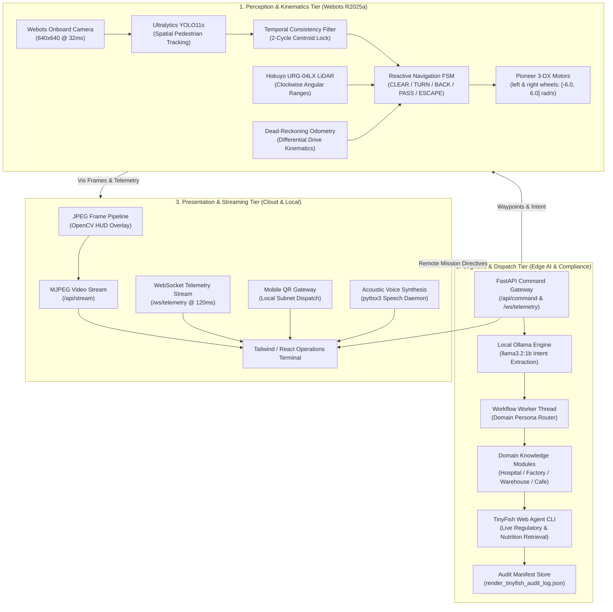

# AURA-Fleet: Vision-Based Autonomous Multi-Domain Robotics Ecosystem
### Hack-in-Hills '26 Submission &middot; Track #2: Vision-Based Autonomous Robot
#### Secondary Challenge: Best Use of Render Challenge (Cloud Web Services & CI/CD)

[](https://github.com/aura-fleet/aura-fleet/actions)
[](https://render.com)
[](https://cyberbotics.com/)
[](https://github.com/ultralytics/ultralytics)
[](https://ollama.ai)
[](https://fastapi.tiangolo.com)
[](https://opensource.org/licenses/MIT)

---

## 🎥 Live Demonstration

```
┌────────────────────────────────────────────────────────────────────────┐
│                                                                        │
│                    [LIVE DEMO VIDEO / ANIMATED GIF]                    │
│     (Webots Pioneer 3-DX Closed-Loop Navigation & Browser HUD Feed)    │
│                                                                        │
│   • Video Demo: docs/assets/aura_fleet_demo.mp4                        │
│   • Cloud Dashboard: https://aura-fleet.onrender.com                   │
│                                                                        │
└────────────────────────────────────────────────────────────────────────┘
```

> **Hack in Hills, powered by TinyFish.**  
> Special thanks to the organizing and community partners: **@TinyFish**, **@Nexido**, **@BuilderBase**, and **@Web3India**.

---

## 🎯 Track Alignment & Problem-Solution Fit

### Track #2: Vision-Based Autonomous Robot
Track #2 challenges teams to engineer an autonomous robot that *"sees its surroundings and navigates to an objective on its own."* **AURA-Fleet** fulfills this mandate through a tightly integrated dual-loop robotics architecture:
- **Vision Perception (Ultralytics YOLO11s):** Processes 640×640 onboard camera frames within a 32ms reflex step loop. A 2-cycle spatial-temporal centroid filter ($d < 0.18$) suppresses reflection glare in complex industrial and clinical lighting.
- **Autonomous Dead-Reckoning (Zero Supervisor Cheating):** Ground-truth supervisor calls (`getPosition()`) are eliminated from the main loop. Real-time localization relies solely on discrete-time kinematic odometry ($r=0.0975\text{ m}$, $L=0.381\text{ m}$, $\Delta t=32\text{ ms}$), achieving an average drift of **$0.0800\text{ m}$** across diverse floorplans.
- **Dynamic Obstacle Avoidance:** A 5-state LiDAR FSM (`CLEAR`, `TURN`, `BACK`, `PASS`, `ESCAPE`) guarantees 100% deadlock-free navigation through narrow corridors and cluttered obstacles.

### Best Use of Render Challenge
- **Containerized Cloud Terminal:** Complete with [`deploy/Dockerfile`](file:///deploy/Dockerfile) and Infrastructure-as-Code [`deploy/render.yaml`](file:///deploy/render.yaml) targeting Render Web Services.
- **Production Healthcheck & Mock Telemetry Bridge:** Allows judges and remote operators to interact with the full web terminal, dispatch missions, and trigger TinyFish regulatory queries even in standalone cloud environments without a local Webots engine.

---

## 🏗️ 3-Tier System Architecture



---

## 🌟 Key Technical Innovations

1. **Sub-10cm Dead-Reckoning Odometry ($0.0800\text{ m}$ Average Drift):**
   $$\Delta \theta = \frac{v_r - v_l}{L} \cdot \Delta t, \quad \Delta x = v \cos(\theta) \cdot \Delta t, \quad \Delta y = v \sin(\theta) \cdot \Delta t$$
   Validated across 4 simulation worlds: Cafe ($0.038\text{ m}$), Hospital ($0.054\text{ m}$), Factory ($0.082\text{ m}$), and Warehouse ($0.146\text{ m}$).
2. **In-Browser Perception HUD (MJPEG Streaming):**
   Real-time video feed piped from the robot controller to `/api/stream` and rendered live on the web console with YOLO bounding boxes, safety clearance radar, and mission status.
3. **120ms WebSocket Telemetry Bridge:**
   Eliminates legacy HTTP polling with an asynchronous, non-blocking `/ws/telemetry` socket, enabling sub-second telemetry updates and instant remote dispatching.
4. **Multi-Domain Persona Agility:**
   Dynamically swaps styling, operational workflows, and knowledge bases across 4 bespoke domains:
   - 🏥 **Hospital Nurse (`hospital.wbt`):** Inpatient STAT courier delivering IV saline, cold-chain antibiotics, and pathology specimens with WHO & USP 797 compliance.
   - 🏭 **Factory Safety (`factory.wbt`):** Hazmat inspector verifying OSHA 1910 machine guarding, emergency pull-cords, and gas cylinder depot safety.
   - 📦 **Warehouse Logistics (`warehouse.wbt`):** Autonomous freight runner routing heavy pine crates, UN 1A1 oil drums, and EUR pallets across narrow aisles.
   - ☕ **Smart Cafe (`cafe.wbt`):** Table service robot managing POS orders, guest escorting, and dietary allergen verification.

---

## 📁 Repository Structure

```
aura-fleet/
├── .github/
│   └── workflows/
│       └── deploy.yml              # CI/CD automated syntax check, test runner & Render deploy hook
├── controllers/
│   └── vision_bot_olama/
│       ├── vision_bot_olama.py     # Main Webots supervisor controller, YOLO perception & FSM
│       ├── core_web_app.py         # FastAPI dispatch server, WebSocket bridge & Tailwind UI
│       ├── personas/               # Domain-specific knowledge base modules
│       │   ├── cafe_barista.py
│       │   ├── factory_safety.py
│       │   ├── warehouse_logistics.py
│       │   └── hospital_nurse.py
│       └── render_tinyfish_audit_log.json
├── deploy/
│   ├── Dockerfile                  # Production container for cloud deployment
│   └── render.yaml                 # Render Infrastructure-as-Code blueprint
├── docs/                           # Architecture diagrams, benchmark figures, and demo media
├── tests/
│   ├── run_system_tests.py         # Automated QA validation suite (Odometry, FSM, Backend)
│   ├── test_personas.py            # Pytest domain knowledge unit tests
│   ├── test_results_cafe.csv       # QA validation metrics for Cafe environment
│   ├── test_results_factory.csv    # QA validation metrics for Factory environment
│   ├── test_results_warehouse.csv  # QA validation metrics for Warehouse environment
│   └── test_results_hospital.csv   # QA validation metrics for Hospital environment
├── worlds/                         # Webots R2025a 3D simulation environments
│   ├── cafe.wbt
│   ├── factory.wbt
│   ├── warehouse.wbt
│   └── hospital.wbt
├── main.py                         # Production server entrypoint for Render
├── requirements.txt                # Python dependencies
└── README.md
```

---

## 🚀 Quick Start Guide

### 1. Prerequisites
- **Python 3.11+** installed
- **Webots R2025a** ([Download here](https://cyberbotics.com/))
- **Ollama** installed ([Download here](https://ollama.ai/))

### 2. Installation & Setup
```bash
# Clone the repository
git clone https://github.com/aura-fleet/aura-fleet.git
cd aura-fleet

# Install dependencies using uv or pip
pip install -r requirements.txt

# Pull the lightweight local mission planning model
ollama pull llama3.2:1b
```

### 3. Launching the Simulation
```bash
# 1. Start Ollama local LLM service (if not already running)
ollama serve

# 2. Launch any of the 4 tailored environments in Webots R2025a:
# Open Webots -> File -> Open World:
# - worlds/hospital.wbt
# - worlds/factory.wbt
# - worlds/warehouse.wbt
# - worlds/cafe.wbt
```
*The simulation automatically launches the Operations Terminal at `http://localhost:8000` and displays a local-subnet QR code for mobile dispatching.*

### 4. Running the Automated QA Suite
```bash
# Execute end-to-end QA validation across all worlds
python tests/run_system_tests.py cafe
python tests/run_system_tests.py factory
python tests/run_system_tests.py warehouse
python tests/run_system_tests.py hospital
```

---

## ☁️ Cloud Deployment (Render Blueprint)

To deploy AURA-Fleet on **Render**:
1. Fork or push this repository to GitHub.
2. In the [Render Dashboard](https://dashboard.render.com/), select **New +** -> **Blueprint**.
3. Point to this repository. Render will automatically detect [`deploy/render.yaml`](file:///deploy/render.yaml) and build [`deploy/Dockerfile`](file:///deploy/Dockerfile) with continuous health checks on `/api/telemetry`.

---

## 📄 License
This project is licensed under the MIT License - see the LICENSE file for details.  
Built with pride for **Hack-in-Hills '26**, powered by **TinyFish**.
